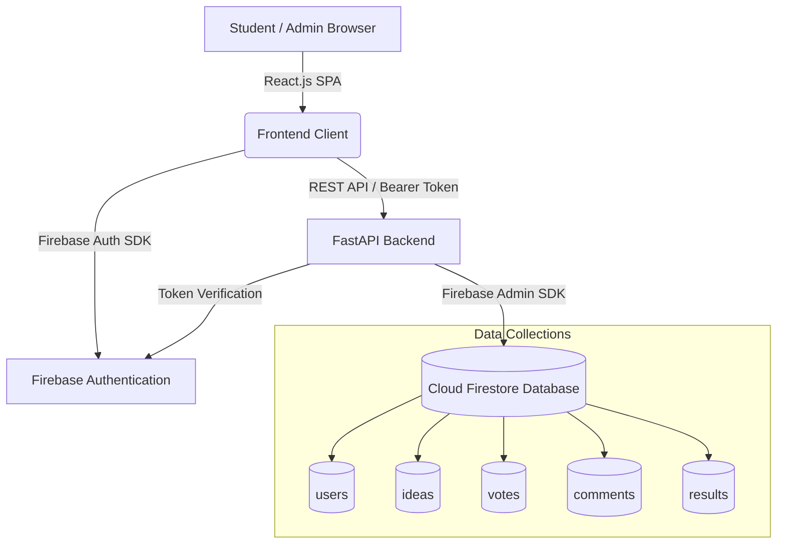

# 🎓 Campus Event Idea & Voting System

[](https://reactjs.org/)
[](https://vitejs.dev/)
[](https://fastapi.tiangolo.com/)
[](https://firebase.google.com/)
[](LICENSE)

A modern, full-stack web application designed to democratize and streamline campus event planning. The platform replaces fragmented workflows (such as paper ballots, WhatsApp polls, and unstructured forms) with a unified, transparent, and auditable digital ecosystem where students propose event ideas, vote, discuss, and track winning campus initiatives.

---

## 📋 Table of Contents

- [Overview & Problem Statement](#-overview--problem-statement)
- [Key Features](#-key-features)
  - [Student Portal](#student-portal)
  - [Administrator Suite](#administrator-suite)
- [System Architecture](#-system-architecture)
- [Technology Stack](#-technology-stack)
- [Repository Structure](#-repository-structure)
- [API Design](#-api-design)
- [Getting Started](#-getting-started)
  - [Prerequisites](#prerequisites)
  - [Frontend Setup](#frontend-setup)
  - [Backend Setup](#backend-setup)
  - [Environment Variables](#environment-variables)
- [User Workflows](#-user-workflows)
- [Security & Validation](#-security--validation)
- [Development Roadmap & Future Scope](#-development-roadmap--future-scope)
- [License](#-license)

---

## 📌 Overview & Problem Statement

### The Problem
Traditional college event planning frequently relies on disparate tools—WhatsApp groups, Google Forms, social media polls, and manual paper sign-ups. These methods create several critical issues:
- **No Single Source of Truth:** Ideas and feedback get scattered and lost across informal channels.
- **Vote Manipulation & Duplicate Voting:** Difficulty verifying student identities and enforcing a strict "one student, one vote" policy.
- **Lack of Transparency:** Students rarely see the progression from idea submission to review, voting, and final approval.
- **Administrative Burden:** Faculty and event heads manually tally votes, filter duplicates, and coordinate discussions.

### The Solution
The **Campus Event Idea & Voting System** establishes a structured lifecycle for student initiatives:
1. **Submission:** Students submit proposals with descriptions, categories, and target audiences.
2. **Moderation:** Administrators review and approve/reject submissions to maintain quality and feasibility.
3. **Community Voting & Discourse:** Students cast verifiable votes and engage in threaded discussions.
4. **Resolution:** Administrators publish official winning events visible to the entire campus body.

---

## ✨ Key Features

### Student Portal
- **Role-Based Authentication:** Secure registration and login (Firebase Auth / JWT).
- **Interactive Proposal Submission:** Submit proposals under categories such as *Technical, Cultural, Sports, Workshops, Hackathons, Entrepreneurship, and Social Initiatives*.
- **Fair Voting Mechanism:** Enforces strict one-vote-per-idea per authenticated student with instant visual confirmation.
- **Community Discussion:** Nested comment sections on idea detail pages for feedback, suggestions, and collaborative refinement.
- **Personalized Student Dashboard:** Track status of submitted ideas (*Pending*, *Approved*, *Rejected*) and review previous voting history.
- **Public Showcase & Winners Page:** View live trending proposals and officially declared winning events.
- **Dynamic Theming:** Seamless dark mode and light mode support with fluid transitions.

### Administrator Suite
- **Executive Control Center:** High-level dashboard displaying active metrics:
  - Total registered students
  - Total submitted proposals
  - Approved vs. Pending vs. Rejected ratios
  - Total votes cast across all categories
- **Moderation Queue (`/admin/manage`):** Review pending ideas with actions to approve, reject, or request revisions.
- **Winner Selection & Publication (`/admin/publish`):** Select highest-voted or committee-approved ideas and publish them to the official results showcase.
- **CSV Data Export:** Export real-time metrics, proposals, and vote statistics to `.csv` for faculty board reviews and archival.
- **Protected Routing:** Strict role verification preventing unauthorized privilege escalation.

---

## 🏗️ System Architecture



### Architectural Highlights
- **Client-Side:** Single Page Application (SPA) built with React 18 and Vite for fast performance and component modularity.
- **API Layer:** Python FastAPI providing async endpoint execution, automatic OpenAPI schema documentation (`/docs`), and request validation via Pydantic.
- **Identity & Persistence:** Firebase Auth manages credentials and issue tokens; Cloud Firestore provides scalable NoSQL document persistence.

---

## 🛠️ Technology Stack

| Layer | Technology | Description |
| :--- | :--- | :--- |
| **Frontend Framework** | **React.js 18** | Functional components with React Hooks (`useState`, `useEffect`, `useContext`) |
| **Routing** | **React Router v6** | Client-side routing with protected admin & user route wrappers |
| **Icons & UI** | **Lucide React** | Clean, accessible vector icons |
| **Styling** | **CSS3 & Design Tokens** | Custom CSS variables for responsive layouts, glassmorphism, and dark/light themes |
| **Build Tool** | **Vite** | Ultra-fast HMR and build bundling |
| **Backend Framework** | **Python FastAPI** | High-performance async REST API framework |
| **Authentication** | **Firebase Auth** | Secure student and admin credential management |
| **Database** | **Google Cloud Firestore** | Scalable NoSQL real-time cloud database |
| **Project Management** | **JIRA & Git** | Agile sprint planning, issue tracking, and version control |

---

## 📂 Repository Structure

```
campus-event-management/
├── src/
│   ├── components/                # Reusable presentation components
│   │   ├── CommentBox.jsx         # Discussion thread & comment submission
│   │   ├── Footer.jsx             # Informational footer with quick links
│   │   ├── IdeaCard.jsx           # Card preview for proposals (category badges, stats)
│   │   ├── Loading.jsx            # Dynamic loading spinner component
│   │   ├── Navbar.jsx             # Responsive navigation with role & theme toggles
│   │   └── VoteButton.jsx         # Interactive vote button with duplicate protection
│   │
│   ├── context/                   # React Context Providers for global state
│   │   ├── AuthContext.jsx        # Authentication state, login/logout, vote synchronization
│   │   └── ThemeContext.jsx       # Theme state manager (Dark / Light mode)
│   │
│   ├── pages/                     # Application routes & views
│   │   ├── Dashboard.jsx          # Student portal with proposal lists and filters
│   │   ├── IdeaDetails.jsx        # Dedicated proposal page with full specs & comments
│   │   ├── LandingPage.jsx        # Hero landing page showcasing features & trending events
│   │   ├── Login.jsx              # Student authentication page
│   │   ├── Profile.jsx            # User profile, statistics, and submission history
│   │   ├── Register.jsx           # Student registration page
│   │   ├── Results.jsx            # Public winner announcement and archive
│   │   ├── SubmitIdea.jsx         # Interactive proposal submission form
│   │   └── admin/                 # Dedicated administrative portal
│   │       ├── AdminDashboard.jsx # Analytics metrics, charts, and CSV export
│   │       ├── AdminLogin.jsx     # Admin authentication gate
│   │       ├── ManageIdeas.jsx    # Moderation approval/rejection queue
│   │       └── ResultsManagement.jsx # Winner selection and publication interface
│   │
│   ├── routes/
│   │   └── AppRoutes.jsx          # Route declarations and Protected Route wrappers
│   │
│   ├── services/
│   │   ├── api.js                 # Centralized fetch client for backend endpoints
│   │   └── firebase.js            # Firebase SDK client initialization
│   │
│   ├── App.jsx                    # Root application component
│   ├── index.css                  # Global design tokens, variables, and typography
│   └── main.jsx                   # React DOM root mounting point
├── package.json
└── README.md
```

---

## 🌐 API Design

The FastAPI backend exposes modular RESTful endpoints categorized by functional scope:

### Authentication & Users
| Method | Endpoint | Description | Access |
| :--- | :--- | :--- | :--- |
| `POST` | `/api/users/register` | Register a new student account | Public |
| `POST` | `/api/users/login` | Authenticate user & issue session token | Public |
| `GET` | `/api/users/me` | Fetch authenticated user profile | Authenticated |

### Event Ideas
| Method | Endpoint | Description | Access |
| :--- | :--- | :--- | :--- |
| `GET` | `/api/ideas?status=&category=` | Query ideas filtered by status and category | Public |
| `GET` | `/api/ideas/:ideaId` | Retrieve detailed metadata for a single idea | Public |
| `POST` | `/api/ideas` | Submit a new event proposal (Pending by default) | Student |
| `PUT` | `/api/ideas/:ideaId` | Edit a submitted proposal | Author / Admin |
| `DELETE` | `/api/ideas/:ideaId` | Delete an idea proposal | Author / Admin |

### Voting & Comments
| Method | Endpoint | Description | Access |
| :--- | :--- | :--- | :--- |
| `POST` | `/api/ideas/:ideaId/vote` | Cast vote (enforces one vote per user) | Student |
| `GET` | `/api/ideas/user/my-votes` | Retrieve list of idea IDs voted by caller | Student |
| `GET` | `/api/ideas/:ideaId/comments` | Fetch comments for an idea | Public |
| `POST` | `/api/ideas/:ideaId/comments` | Post a comment on an idea | Authenticated |
| `DELETE` | `/api/comments/:commentId` | Delete a comment | Author / Admin |

### Admin Moderation & Publishing
| Method | Endpoint | Description | Access |
| :--- | :--- | :--- | :--- |
| `GET` | `/api/admin/dashboard` | Fetch platform KPIs & aggregate statistics | Admin |
| `GET` | `/api/admin/ideas` | List all proposals including pending/rejected | Admin |
| `PUT` | `/api/admin/ideas/:id/approve` | Approve a proposal for public voting | Admin |
| `PUT` | `/api/admin/ideas/:id/reject` | Reject proposal with moderation notes | Admin |
| `POST` | `/api/admin/results` | Designate and publish official winning event | Admin |
| `GET` | `/api/results` | Fetch published winning events | Public |

---

## 🚀 Getting Started

### Prerequisites
- **Node.js** (v18.x or later)
- **npm** (v9.x or later) or **yarn**
- **Python** (v3.10 or later)
- A **Firebase Project** with Firestore and Authentication enabled

---

### Frontend Setup

1. **Clone the repository:**
   ```bash
   git clone https://github.com/your-username/campus-event-management.git
   cd campus-event-management
   ```

2. **Install dependencies:**
   ```bash
   npm install
   ```

3. **Start the development server:**
   ```bash
   npm run dev
   ```
   The client will be running at `http://localhost:5173`.

---

### Backend Setup (FastAPI)

1. **Navigate to the backend directory:**
   ```bash
   cd backend
   ```

2. **Create and activate a virtual environment:**
   ```bash
   # Windows
   python -m venv venv
   .\venv\Scripts\activate

   # macOS / Linux
   python3 -m venv venv
   source venv/bin/activate
   ```

3. **Install dependencies:**
   ```bash
   pip install -r requirements.txt
   ```

4. **Launch the FastAPI server:**
   ```bash
   uvicorn app.main:app --reload --port 8000
   ```
   Interactive Swagger documentation will be available at `http://localhost:8000/docs`.

---

### Environment Variables

Create a `.env` file in the project root with the following configuration:

```env
# Frontend (Vite)
VITE_API_BASE_URL=/api
VITE_FIREBASE_API_KEY=your_firebase_api_key
VITE_FIREBASE_AUTH_DOMAIN=your_project.firebaseapp.com
VITE_FIREBASE_PROJECT_ID=your_project_id
VITE_FIREBASE_STORAGE_BUCKET=your_project.appspot.com
VITE_FIREBASE_MESSAGING_SENDER_ID=your_messaging_sender_id
VITE_FIREBASE_APP_ID=your_app_id

# Backend (FastAPI)
FIREBASE_CREDENTIALS_PATH=./serviceAccountKey.json
SECRET_KEY=your_super_secret_jwt_key
ALGORITHM=HS256
ALLOWED_ORIGINS=http://localhost:5173
```

---

## 🔄 User Workflows

### 👩‍🎓 Student Journey
1. **Onboarding:** Register with college credentials and sign in.
2. **Explore:** Browse approved event concepts on the Dashboard filtered by category (*Hackathons, Cultural, Sports, etc.*).
3. **Propose:** Submit a new idea through the `/submit` view. The idea enters the `Pending` review state.
4. **Participate:** Vote on approved ideas and participate in discussion threads.
5. **Review Results:** Visit `/results` to view final winning events selected for campus execution.

### 👨‍💼 Administrator Journey
1. **Access:** Log in through the protected `/admin/login` portal.
2. **Review Queue:** Check `/admin/manage` to evaluate pending submissions and inspect proposal details.
3. **Decision:** Approve quality ideas (moving them to `Approved` state for public voting) or reject non-compliant ideas.
4. **Monitor Analytics:** Track engagement metrics and voter participation on `/admin`.
5. **Publish Results:** In `/admin/publish`, finalize the voting round, pick the top event, and publish official results to all students.

---

## 🔒 Security & Validation

- **No Frontend-Only Gates:** While the client utilizes route guards (`ProtectedAdminRoute` and `ProtectedUserRoute`), all permissions and role checks are re-evaluated and validated on the backend with verified tokens.
- **Vote Integrity Guarantee:**
  - Duplicate vote prevention is enforced on the database level by indexing composite keys: `vote_id = {userId}_{ideaId}`.
  - Transactions ensure atomic updates to idea vote counters.
- **Input Sanitization:** String inputs are validated on both frontend and backend (via Pydantic) to prevent XSS and payload injections.
- **Sensitive Credentials:** Firebase Service Account credentials are kept strictly in server-side environment variables and are excluded from version control via `.gitignore`.

---

## 🗺️ Development Roadmap & Future Scope

- [x] Initial React 18 frontend component architecture
- [x] Context-based authentication and theme toggling
- [x] Protected route wrappers for student and administrative roles
- [x] Full REST API integration service layer (`api.js`)
- [ ] Real-time vote synchronization using Firestore snapshot listeners
- [ ] Automated push/email notifications for idea approval and winner announcements
- [ ] Exportable event calendar integration (Google Calendar & iCal)
- [ ] Department-specific voting rounds and multi-stage tournament brackets

---

## 📄 License

This project is licensed under the [MIT License](LICENSE) — free for educational and institutional adaptation.
